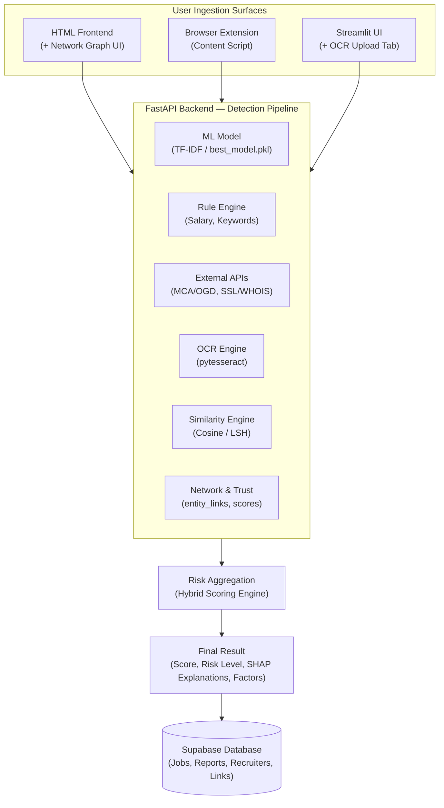

# TrustHire — Project Brief
## Fake Internship & Job Scam Detection System — Extended Version (v2)

---

### 1. Vision
The original ScamGuard AI scored a single job posting in isolation: 
`text + salary + domain + recruiter → SCAM / GENUINE`. 

That's a solid hybrid ML + rule-based system, but it treats every posting as a fresh, unrelated event.

**Version 2.0** reframes the project from *"a classifier"* to **"a fraud intelligence platform"**: 
- It remembers scammers across postings.
- Explains itself visually (Explainable AI).
- Reaches users where scams actually happen (WhatsApp screenshots, browser tabs).
- Builds trust over time instead of resetting to zero on every check.

*Everything below is designed to be built on top of your existing FastAPI + Supabase + ML pipeline — no rewrite required.*

---

### 2. What's New vs. the Original System

| Area | v1 (existing) | v2 (this brief) |
| :--- | :--- | :--- |
| **Scope of analysis** | One posting at a time | Cross-posting pattern detection (network graph, duplicates) |
| **Input formats** | Typed text / job URL | + Screenshot upload (OCR) |
| **Reach** | Web app + Streamlit demo | + Browser extension (in-page detection) |
| **Trust model** | One-shot verdict | Running Trust Score per recruiter/company |
| **Explainability** | Rule-based factor list | + SHAP-based ML explanation (which words drove the score) |
| **Data usage** | Reports stored, not cross-analyzed | Reports/postings actively linked and mined for patterns |

---

### 3. Complete Feature List

#### Carried over from v1 (unchanged, still the foundation):
- **Job URL scraping** (`scrape_job_url`)
- **Domain extraction + security check** (SSL, domain age)
- **MCA/OGD company verification**
- **Recruiter email classification** (personal/temp email detection)
- **Salary parsing + realism scoring**
- **NLP fraud-keyword + TF-IDF/BoW/n-gram ML classifier**
- **Hybrid scoring engine with rule-based fallback**
- **/api/report community reporting**
- **/api/dashboard monitoring stats**
- **Streamlit demo interface** (URL check, full analysis, batch CSV)

#### New in v2:
1. **Scam Network Graph**
2. **Near-Duplicate Scam Detection**
3. **Browser Extension (Chrome/Edge)**
4. **OCR Screenshot Analysis**
5. **Recruiter/Company Trust Score**
6. **SHAP-Based Explainability**
7. **Tiered Hybrid Scoring & Hard Veto Overrides**

---

### 4. New Features — Design & Implementation Steps

#### 4.1 Scam Network Graph — *"Same Scammer, Different Mask"*
- **What it does:** Links recruiter emails, phone numbers, domains, and company names that co-occur across analyzed postings and reports, revealing when one actor is operating under multiple fake identities.
- **Why it matters:** This is the single most differentiating feature — it turns isolated data points you already store into a fraud-ring detector.
- **Implementation steps:**
  1. Add a lightweight `entity_links` table in Supabase: `(entity_a, entity_a_type, entity_b, entity_b_type, co_occurrence_count, first_seen, last_seen)` where `type ∈ {email, phone, domain, company_name}`.
  2. On every `/api/analyze` and `/api/report` call, extract all identity fields from the posting and upsert pairwise links between them (e.g. recruiter email ↔ domain ↔ company name all seen together → link each pair, increment count).
  3. Build a `/api/network/{entity}` endpoint that does a graph traversal (2–3 hops) from a given entity and returns connected nodes/edges as JSON.
  4. Visualize with `vis-network.js` or `D3.js` force-directed graph in the frontend — nodes colored by type, edge thickness by co-occurrence count.
  5. Surface it directly in the result page: *"⚠️ This recruiter is linked to 4 other company names and 2 domains flagged in the last 30 days."*
- **Tech needed:** No new backend framework — just a new table + graph traversal query (simple recursive SQL or NetworkX in Python if graphs get large) + `vis-network.js` or `D3.js` on the frontend.

---

#### 4.2 Near-Duplicate Scam Detection
- **What it does:** Flags when a new posting's description is highly similar to a previously reported scam, even if the company name/domain has changed.
- **Implementation steps:**
  1. You already generate TF-IDF vectors (`tfidf.pkl`) for every analyzed posting — store each posting's vector (or a compressed hash of it) alongside its record in Supabase/SQLite.
  2. On each new `/api/analyze` call, compute cosine similarity between the new posting's TF-IDF vector and vectors of postings previously labelled `SCAM` (start with a simple linear scan; if the dataset grows large, move to MinHash + LSH via the `datasketch` Python library for sub-linear lookup).
  3. If similarity > threshold (e.g. 0.85), add a factor: *"This posting is 92% similar to a scam reported on [date] under a different company name."*
  4. Feed this as an additional signal into the rule-based scoring engine (`duplicate_risk` alongside `text_fraud_score`, `url_risk_score`, etc.).
- **Tech needed:** `scikit-learn` (cosine similarity — already a dependency via TF-IDF), optionally `datasketch` for scale.

---

#### 4.3 Browser Extension (Chrome/Edge)
- **What it does:** Scans job listings on sites like LinkedIn, Naukri, or Internshala directly in-page and shows a colored risk badge without the user needing to copy-paste anything into your web app.
- **Implementation steps:**
  1. `manifest.json` (Manifest V3) declaring a content script for target domains (`linkedin.com/jobs/*`, `internshala.com/*`, etc.) and host permissions for your deployed Render API.
  2. Content script (`content.js`) scrapes the visible job title, company, description, and salary from the page DOM (site-specific selectors — start with 1–2 platforms, not all).
  3. Content script calls your existing deployed `POST /api/analyze` endpoint with the scraped data (same payload shape your FastAPI backend already accepts).
  4. Inject a floating badge (🟢 Low Risk / 🟡 Medium / 🔴 High) near the job title, with a click-to-expand panel showing the factor list from `generate_factors_list()`.
  5. Package with a simple popup (`popup.html`) showing recent scans and a manual "Analyze this page" button as a fallback if auto-detection misses the layout.
- **Tech needed:** Vanilla JS/HTML/CSS (Manifest V3), no new backend work — it's a client that calls your existing API.

---

#### 4.4 OCR Screenshot Analysis
- **What it does:** Lets users upload a WhatsApp/Telegram screenshot of a scam offer — the most common real-world format in India — and runs the extracted text through your existing pipeline.
- **Implementation steps:**
  1. New endpoint `POST /api/analyze-image` accepting an image file upload (FastAPI `UploadFile`).
  2. Use Tesseract OCR (via `pytesseract` + `Pillow`) to extract raw text from the image.
  3. Pass the extracted text into your existing text-analysis pipeline (`FRAUD_KEYWORDS`, TF-IDF/ML model, salary regex) exactly as if it were typed/pasted text.
  4. Return the same response shape as `/api/analyze` (scam score, risk level, factors) plus the raw OCR text for transparency, so the user can correct obvious OCR errors and re-submit if needed.
  5. Add an "Upload Screenshot" tab to both the Streamlit app and the static frontend.
- **Tech needed:** `pytesseract`, `Pillow`, the Tesseract OCR binary (available via `apt` on Render/Linux).

---

#### 4.5 Recruiter / Company Trust Score
- **What it does:** Converts one-shot verdicts into a running reputation score per recruiter/company that updates as more postings and reports come in.
- **Implementation steps:**
  1. Extend the existing `recruiters` table with `trust_score` (0–100), `postings_analyzed`, `reports_against`, `last_updated`.
  2. After each `/api/analyze` or `/api/report` call involving a known recruiter/company, recompute their score with a simple weighted formula, e.g.:
     $$\text{trust\_score} = 100 - (\text{avg\_scam\_score\_of\_their\_postings} \times 0.6) - (\text{reports\_against} \times 5)$$
     *(clamped to [0, 100])*
  3. New endpoint `GET /api/recruiter-check` (you already have the route — extend its response) to return the trust score, posting history, and report history.
  4. Show it prominently in the UI: *"Trust Score: 72/100 · 5 postings analyzed · 1 report filed."*
  5. Optionally decay the score slowly over time for inactive recruiters, so old reports don't permanently sink a since-improved account.
- **Tech needed:** No new libraries — just schema + a scoring function in `scoring_engine.py`.

---

#### 4.6 SHAP-Based Explainability
- **What it does:** Shows which specific words/features in the description pushed the ML model's prediction toward `SCAM` — both a great demo feature and a genuine debugging tool for the overfitting issue your team observed.
- **Implementation steps:**
  1. Add `shap` to your Python dependencies.
  2. After the ML model (`best_model.pkl`) makes a prediction, run a `TreeExplainer` (if your model is tree-based, e.g. Random Forest/XGBoost) or `LinearExplainer`/`KernelExplainer` otherwise, on the TF-IDF feature vector for that specific prediction.
  3. Extract the top 5–8 highest-impact features (words/n-grams) and their SHAP values.
  4. Add these to the `/api/analyze` response as `ml_explanation: [{"term": "registration fee", "impact": 0.34}, ...]`.
  5. Render as a simple horizontal bar chart in the frontend (red = pushes toward scam, green = pushes toward genuine).
  6. **Bonus for your viva:** If SHAP reveals the model leaning on spurious tokens (e.g. a specific city name that happened to correlate with scams in training data), that's direct, visual evidence of the overfitting you already flagged — turning a weakness into a demonstrated diagnostic capability.
- **Tech needed:** `shap` (pip-installable, works with scikit-learn models).

---

#### 4.7 Hybrid Scoring & Risk Aggregation Engine
- **What it does:** Aggregates multi-source fraud signals into a unified final risk score (0–100%) and categorizes postings into Low Risk (0–39%), Medium Risk (40–69%), and High Risk (70–100%).
- **Evolution from v1 to v2:**
  - **v1 Baseline:** A static 50/50 split between ML text probability and heuristic rule penalties:
    $$\text{Final Risk Score (v1)} = (0.50 \times \text{ML Text Score}) + (0.50 \times \text{Rule-Based Score})$$
  - **v2 Advanced Engine:** Uses a **Tiered Hybrid Architecture with Hard Veto Overrides** to prevent sophisticated scammers with clean text descriptions from bypassing detection.
- **Scoring Logic & Weight Distribution:**
  1. **Tier 1: Hard Veto Overrides (Instant High Risk $\ge 85\%$):**
     - Contains explicit demands for upfront money (regex matches: *"security deposit"*, *"registration fee"*, *"training cost"*, *"laptop insurance"*).
     - High near-duplicate cosine similarity ($> 0.90$) against confirmed scam listings.
     - Recruiter identifier (phone, email, domain) linked to $\ge 2$ confirmed fraud rings in `entity_links`.
  2. **Tier 2: Weighted Multi-Signal Baseline (When no veto applies):**
     - **35% ML NLP Score:** Output probability of `best_model.pkl` on TF-IDF features.
     - **25% Rule-Based Engine:** Free/disposable recruiter email, young domain age, invalid SSL, MCA company registration failure, salary-to-experience realism anomaly.
     - **25% Network & Recruiter Trust Score:** Historical reputation score derived from previous reports and graph connections.
     - **15% Near-Duplicate Score:** Cosine similarity against the historical scam posting vector pool.
- **Tech needed:** Python business logic in `scoring_engine.py` (no external dependency required).

---

### 5. Updated System Architecture



---

### 6. Updated Tech Stack

| Layer | Technology | Status |
| :--- | :--- | :--- |
| **Frontend (web)** | HTML, CSS, JavaScript | Existing |
| **Frontend (graph viz)** | `vis-network.js` or `D3.js` | **New** |
| **Secondary UI** | Streamlit | Existing (+ OCR upload tab) |
| **Browser client** | Chrome Extension (Manifest V3) | **New** |
| **Backend** | FastAPI + Uvicorn | Existing |
| **ML — text features** | TF-IDF, Bag-of-Words, n-grams (`scikit-learn`) | Existing |
| **ML — classifier** | `best_model.pkl` (Random Forest / XGBoost or similar) | Existing |
| **ML — explainability** | `shap` | **New** |
| **Similarity detection** | `scikit-learn` cosine similarity, optionally `datasketch` (MinHash/LSH) | **New** |
| **OCR** | `pytesseract` + `Pillow` + Tesseract binary | **New** |
| **Company verification** | MCA / OGD API | Existing |
| **Domain security** | SSL / WHOIS checks | Existing |
| **Database** | Supabase (Postgres) / SQLite fallback | Existing (+ new tables) |
| **Deployment** | Render (static site + web service) | Existing |

---

### 7. Database Schema Additions

```sql
-- Scam network graph
CREATE TABLE entity_links (
    id SERIAL PRIMARY KEY,
    entity_a TEXT NOT NULL,
    entity_a_type TEXT NOT NULL, -- email, phone, domain, company_name
    entity_b TEXT NOT NULL,
    entity_b_type TEXT NOT NULL,
    co_occurrence_count INT DEFAULT 1,
    first_seen TIMESTAMP DEFAULT now(),
    last_seen TIMESTAMP DEFAULT now()
);

-- Near-duplicate detection support
ALTER TABLE jobs ADD COLUMN tfidf_vector_hash TEXT;

-- Trust scoring
ALTER TABLE recruiters ADD COLUMN trust_score INT DEFAULT 50;
ALTER TABLE recruiters ADD COLUMN postings_analyzed INT DEFAULT 0;
ALTER TABLE recruiters ADD COLUMN reports_against INT DEFAULT 0;
ALTER TABLE recruiters ADD COLUMN trust_last_updated TIMESTAMP;
```

---

### 8. API Endpoints — Full List (v1 + v2)

| Endpoint | Method | Status | Description |
| :--- | :--- | :--- | :--- |
| `/` | `GET` | Existing | Health check / API status |
| `/api/scrape` | `GET` | Existing | Scrapes raw job content from job URL |
| `/api/analyze` | `POST` | Existing (Extended) | Returns score, risk level, factors + `ml_explanation`, `network_warnings`, `duplicate_risk` |
| `/api/report` | `POST` | Existing | Community reporting endpoint |
| `/api/recruiter-check` | `GET` | Existing (Extended) | Extended with `trust_score` and `posting_history` |
| `/api/domain-check` | `GET` | Existing | WHOIS and SSL certificate checks |
| `/api/dashboard` | `GET` | Existing | Monitoring stats and aggregates |
| `/api/analyze-image` | `POST` | **New** | OCR screenshot analysis endpoint |
| `/api/network/{entity}` | `GET` | **New** | Graph traversal for scam network |

---

### 9. Implementation Roadmap

#### Phase 1 — Stabilize the base (Week 1–2)
- Address the overfitting issue: re-check for data leakage/duplicates, add cross-validation, regularize the model.
- Confirm all existing v1 endpoints are stable and deployed.

#### Phase 2 — High-impact, low-effort wins (Week 2–3)
- Recruiter/Company Trust Score (schema + scoring function only).
- SHAP explainability (single new dependency, hooks into existing model).

#### Phase 3 — Data-driven features (Week 3–5)
- Near-duplicate detection (reuses existing TF-IDF vectors).
- Scam Network Graph (new table + traversal + frontend viz).

#### Phase 4 — Reach features (Week 5–7)
- OCR screenshot analysis.
- Browser extension MVP (target 1 platform first, e.g. LinkedIn or Internshala).

#### Phase 5 — Polish & demo prep (Week 7–8)
- Wire all new signals into the dashboard.
- Prepare a live demo flow: 
  `paste scam screenshot → OCR → flagged → show network graph of the scammer's other identities → show trust score`.

---

### 10. Advantages of Proposed v2
- Reframes the product from a one-shot classifier to a **fraud intelligence platform** that gets smarter with use.
- **Scam Network Graph** and **Trust Score** turn already-collected report data into active detection signals instead of a passive log.
- **Browser extension** and **OCR upload** meet users where scams actually appear, instead of requiring manual copy-paste into a separate app.
- **SHAP explainability** directly demonstrates (and helps diagnose) the overfitting issue already identified, turning a known weakness into evidence of rigorous evaluation.
- All new features build on existing infrastructure (FastAPI, Supabase, TF-IDF pipeline) — **no architectural rewrite needed**.

---

### 11. Disadvantages / Limitations of Proposed v2
- **Cold-start problem:** Network graph and trust scoring only become useful once enough reports/postings accumulate.
- **OCR sensitivity:** OCR accuracy depends on screenshot quality; low resolution or stylized fonts can produce degraded text extraction.
- **DOM selector fragility:** Browser extension requires per-site DOM scraping logic — brittle if a job platform changes its page structure, and realistically only covers 1–2 platforms initially.
- **Cosine similarity false positives:** Near-duplicate detection can produce false matches between unrelated but topically similar genuine postings (e.g. two legitimate "data entry" roles).
- **Latency overhead:** SHAP computation adds latency to each `/api/analyze` call, especially for non-tree-based models — needs to be optimized or scoped to top features.
- **Short-term gaming:** Trust scores can be gamed short-term by a new scammer with a fresh identity and no history — mitigating this requires the network graph feature to mature alongside it.
